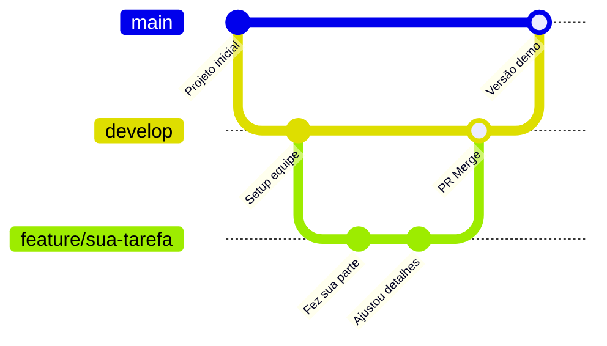

# 🏆 Guia Git Flow & Dicas para o Hackathon (Devs criam com IA)

Olá, **Madu**! Este guia foi feito especialmente para você ter em mãos durante todo o hackathon. Ele traz o fluxo de trabalho exato que os times de tecnologia usam para colaborar em equipe sem dor de cabeça e sem sobrescrever o código dos outros.

---

## 🛑 As 3 Regras de Ouro do Hackathon

1. **A branch `main` é sagrada:** É onde fica a versão estável que vai ser apresentada pros jurados. Nunca faça alterações direto nela.
2. **Trabalhe sempre na sua branch:** Cada funcionalidade ou tarefa ganha uma branch própria (ex: `feature/tela-login`, `feature/prompt-ia`).
3. **Cuidado com chaves de API (`.env`):** Nunca envie arquivos com senhas ou chaves de API para o GitHub. O arquivo `.gitignore` já está configurado para te proteger.

---

## 🔄 Fluxo de Trabalho Passo a Passo (Seu dia a dia)



### 1️⃣ Antes de começar qualquer tarefa: Atualize seu código
Antes de criar qualquer coisa nova, garanta que você tem o código mais recente do time:
```bash
git checkout develop
git pull origin develop
```
*(Se o time estiver usando direto a `main`, troque `develop` por `main`)*.

---

### 2️⃣ Crie sua branch para a tarefa específica
Dê um nome curto e claro que descreva o que você vai fazer:
```bash
git checkout -b feature/nome-da-sua-tarefa
```
*Exemplos:*
- `git checkout -b feature/interface-chat`
- `git checkout -b feature/integracao-gemini`
- `git checkout -b feature/card-resultado`

---

### 3️⃣ Trabalhe no código e salve suas alterações (Commit)
Quando terminar uma parte ou fizer algo que esteja funcionando:
```bash
# 1. Veja o que você alterou
git status

# 2. Adicione as mudanças
git add .

# 3. Salve com uma mensagem clara do que foi feito
git commit -m "feat: cria o layout inicial do chat"
```

> **Dica do Vault:** Mensagens de commit com prefixos organizam o projeto:
> - `feat:` para nova funcionalidade (ex: `feat: adiciona botão de enviar`)
> - `fix:` para correção de bugs (ex: `fix: corrige alinhamento do texto`)
> - `style:` para mudanças visuais e CSS (ex: `style: ajusta cores do tema`)

---

### 4️⃣ Envie sua branch para o GitHub
Pela primeira vez na branch:
```bash
git push -u origin feature/nome-da-sua-tarefa
```
Nos próximos envios da mesma branch, basta:
```bash
git push
```

---

### 5️⃣ Abra um Pull Request (PR) no GitHub
1. Vá no repositório no navegador (GitHub).
2. O GitHub vai mostrar um botão verde chamativo: **"Compare & pull request"**. Clique nele!
3. Escreva resumidamente o que você fez:
   - Exemplo: *"Criei os componentes de input e botão para envio do prompt."*
4. Marque alguém do time para dar uma olhadinha e aprovar (Merge).
5. Depois que o PR for aprovado e mesclado, o código de todos já estará junto!

---

## ⚡ Comandos Rápidos de Emergência (Cola Rápida)

| O que você quer fazer? | Comando |
|---|---|
| Ver em qual branch estou | `git branch` |
| Ver o que foi alterado | `git status` |
| Ver exatamente as linhas alteradas | `git diff` |
| Guardar mudanças temporárias sem commitar | `git stash` |
| Recuperar o que guardou | `git stash pop` |
| Voltar para a branch principal | `git checkout main` |
| Puxar o código mais recente do time | `git pull` |

---

## 🚨 Teve Conflito no Merge? Calma, é normal!
Quando duas pessoas alteram a mesma linha de um mesmo arquivo, o Git avisa que houve um **conflito**.
- Abra o arquivo no **VS Code**.
- O VS Code vai destacar a área com botões fáceis no topo da linha:
  - **Accept Current Change** (fica com a sua versão)
  - **Accept Incoming Change** (fica com a versão que veio do colega)
  - **Accept Both Changes** (mantém as duas)
- Escolha a opção correta, salve o arquivo (`Cmd+S`), adicione e commite:
  ```bash
  git add .
  git commit -m "fix: resolve conflito na branch"
  git push
  ```

---

## 🧠 Dicas Estratégicas de TI & IA para o Hackathon

### 1. Foco no MVP (Mínimo Produto Viável)
- Em hackathons, **uma funcionalidade que funciona de ponta a ponta** vale 10x mais do que um sistema gigante incompleto que dá erro na apresentação.
- Combine com o time: *"O que o usuário precisa ver funcionando no vídeo/pitch de 3 minutos?"*

### 2. Dica de Engenharia de Prompt (Do Vault / LangChain)
Ao conectar a IA na aplicação:
- **System Prompt bem definido:** Diga exatamente a persona e o formato de resposta desejado.
- **Forçar saída estruturada:** Peça para a IA responder sempre em **JSON** se você precisar renderizar dados na tela, ou seja bem explícita quanto a títulos e tópicos.
- *Exemplo de prompt:*
  > "Você é um assistente especialista em [tema]. Analise a entrada do usuário e retorne a resposta no seguinte formato JSON: { 'titulo': '...', 'resumo': '...', 'acoes': ['...'] }. Não inclua explicações fora do JSON."

### 3. Organização no GitHub Projects / Issues (Do Vault)
- Criem 5 a 10 cartões rápidos no GitHub Issues ou num Kanban simples:
  - **A Fazer (To Do)**
  - **Em Andamento (In Progress)**
  - **Pronto (Done)**
- Isso evita que duas pessoas façam a mesma coisa ao mesmo tempo.

---
✨ **Você vai arrasar no hackathon! Mantenha a calma, colabore bastante e divirta-se criando!**
