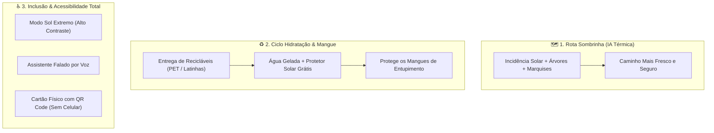

# ☂️ Sombrinha — Resiliência Climática e Cuidado Social no Recife

> **Hackathon Antena na Lama — APONTI Academy & Movimento Pró-Criança**  
> *Caminho: Alertar e Proteger & Prevenir e Cuidar*

O **Sombrinha** é uma plataforma inteligente e acessível de adaptação urbana a eventos climáticos extremos (ondas de calor e chuvas intensas) na Região Metropolitana do Recife (RMR). 

Inspirado no maior símbolo cultural de resistência e proteção de Pernambuco — a **sombrinha de frevo** —, o projeto protege quem mais sofre no asfalto quente e retira o plástico das ruas antes que ele sufoque nossos rios e manguezais.

---

## 👥 Equipe
- **Artur Leone** ([@Artur-Leone](https://github.com/Artur-Leone))
- **Madu Barretto** ([@madubt](https://github.com/madubt))
- *(Membros da equipe)*

---

## 🎯 O Problema
Na Região Metropolitana do Recife, as ondas de calor e as ilhas de calor urbano castigam diariamente os pedestres mais vulneráveis: **crianças de comunidades a caminho da escola, trabalhadores informais ambulantes, idosos e catadores de recicláveis**.
Simultaneamente, toneladas de resíduos plásticos jogados nas vias públicas são levados pelas primeiras chuvas torrenciais, entupindo canais e poluindo os manguezais da bacia do Rio Capibaribe.

---

## 💡 A Solução: Os 3 Pilares do Sombrinha



1. **Rota Sombrinha (IA de Microclima Urbano):** Não calcula apenas a distância, mas o trajeto com **maior cobertura de sombra** (copas de árvores, marquises comerciais e paradas de ônibus cobertas) e pontos de água potável no caminho.
2. **Ecopontos & Refúgio Climático:** Locais parceiros (comércios, Compaz, pontos de apoio) onde a entrega de materiais recicláveis dá pontos para resgatar **água mineral gelada e protetor solar**.
3. **Acessibilidade Inclusiva (Universal):**
   - **Modo Sol Extremo:** Interface em alto contraste para visualização sob luz solar direta intensa.
   - **Comando por Voz e Áudio:** Para crianças e pessoas com baixa escolaridade.
   - **Cartão Físico do Cidadão:** Crachá simples com QR Code para quem não tem smartphone nem plano de dados.

---

## 🛠️ Arquitetura e Tecnologias

- **Frontend:** React.js, Vite, Leaflet / OpenStreetMap, CSS3 Responsivo e Acessível (WCAG AA).
- **Backend:** Node.js (ES Modules), Express.js, REST API.
- **Banco de Dados:** PostgreSQL + Prisma ORM.
- **Inteligência Artificial:** Camada isolada `AIService` com motor de cálculo de estresse térmico e categorização de resíduos com fallback simulado.
- **CI / DevOps:** GitHub Actions, pronto para deploy na **Vercel** (Frontend) e **Render** (Backend).

---

## ⚡ Como Executar o Projeto Localmente

### Pré-requisitos
- Node.js 18+ (testado no Node.js v22)
- npm 9+

### 1. Backend (API)
```bash
cd backend
npm install
npm run dev
# Servidor rodará em http://localhost:3001
# Testes: npm test
```

### 2. Frontend (Aplicação Web)
```bash
cd frontend
npm install
npm run dev
# Aplicação rodará em http://localhost:5173
```

---

## 🧪 Testes Automatizados
O backend conta com suíte de testes com **Vitest** e **Supertest** cobrindo a integridade dos endpoints e middlewares:
```bash
cd backend
npm test
```
